<div align="center">


# Homelab

**Everything running in your homelab, in one place — and an assistant that can do the work for you.**

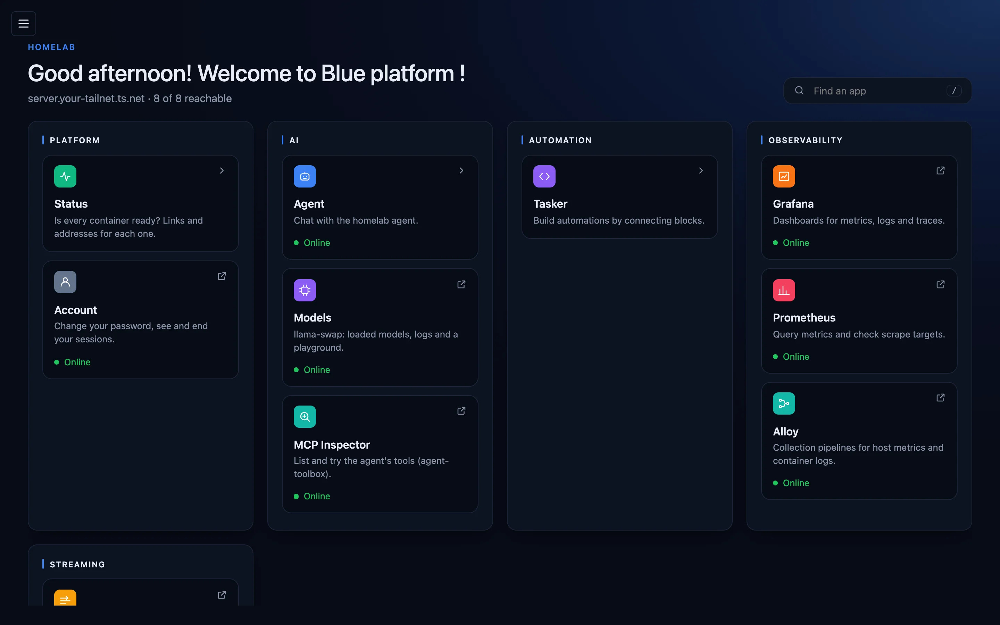

</div>

## See everything at a glance

The overview lists every app in your homelab, grouped by what it does — Platform, AI, Automation, Observability, Streaming. Each tile tells you straight away whether the app is **online**, and one click opens it. Looking for something? Start typing in **Find an app** — or just press <kbd>/</kbd>.

## Check every container

The **Status** page lists every container of the homelab, grouped the way the server is organised — Gateway, Repository, Message broker, Observability, AI, Apps — each marked **Ready**, **Not ready** or **Unknown**. The top line counts how many are ready; the page checks again every 30 seconds, or at once with **Check now**.

Every service also carries what you need to use it:

- **links** to its web interfaces — Grafana's dashboards and Explore, Prometheus queries and targets, Kafka UI, Alloy's pipeline graph, the LLM playground, the agent's API docs, your Keycloak account;
- its **connection address**, ready to copy — `postgres:5432` style for PostgreSQL, the MongoDB URI, Kafka's bootstrap server, the OTLP endpoints, the LLM's OpenAI-compatible URL;
- the **folder** it lives in on the server, for when you need to look at its configuration.

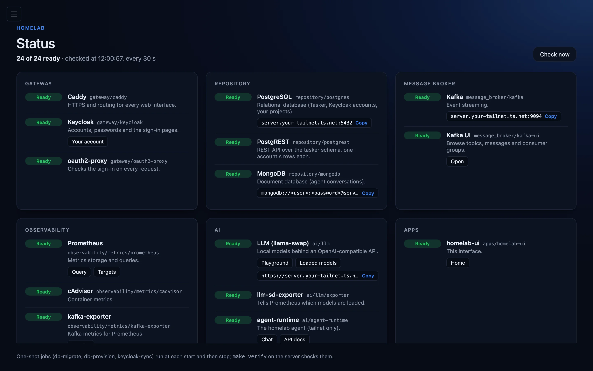

## Ask the agent

Ask in plain words, the way you would ask a colleague: _"Summarise sales.csv by region"_, _"What's in change.md?"_, _"Which tools can you use?"_.

A question it can answer straight away — _"What is a KV cache?"_ — comes back **as it is written**: the words appear one after another, so you can start reading at once.

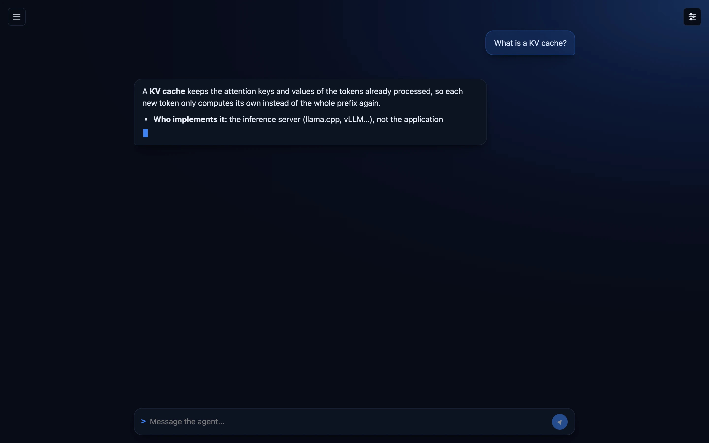

When a request needs real work — reading files, crunching numbers, saving a report — the agent first shows you **its plan**. Reply **yes** and it gets to work, showing what it is doing as it goes, then gives you the result. Reply **Drop plan** to cancel it, or say what to change and it comes back with a new plan.

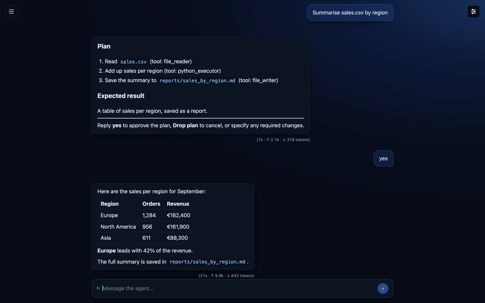

Under each answer you see how long it took and how many tokens went in and out, like _(21s · ↑ 9.9k · ↓ 642 tokens)_. Hover over the answer for a button that copies it, and an arrow that opens everything the agent reported about it: the model, the tools it used, the steps it took, and any detail the agent adds later.

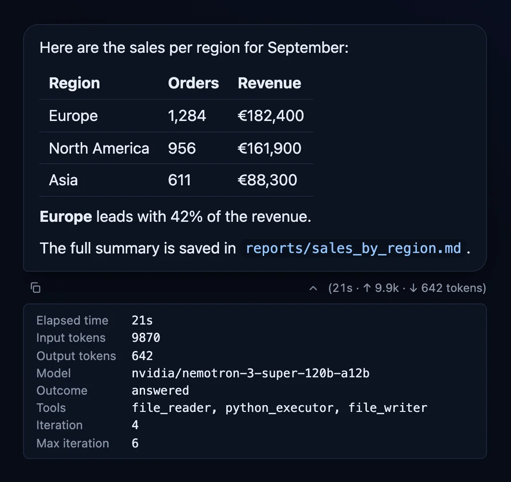

## Stay in control

The settings panel lets you choose the **model** that answers, start a **new conversation**, or pick up an old one by pasting its id. The list of models comes from the agent itself: when a new model is added there, it shows up here.

Trust the agent with a task? Turn on **Auto-approve plans** and it carries out its plans without waiting for your yes. Your model and auto-approve choices are **remembered** on that device.

At the bottom, **Fixed by the server** shows the steps that always use the same model whatever you pick — for example understanding your request or writing a plan.

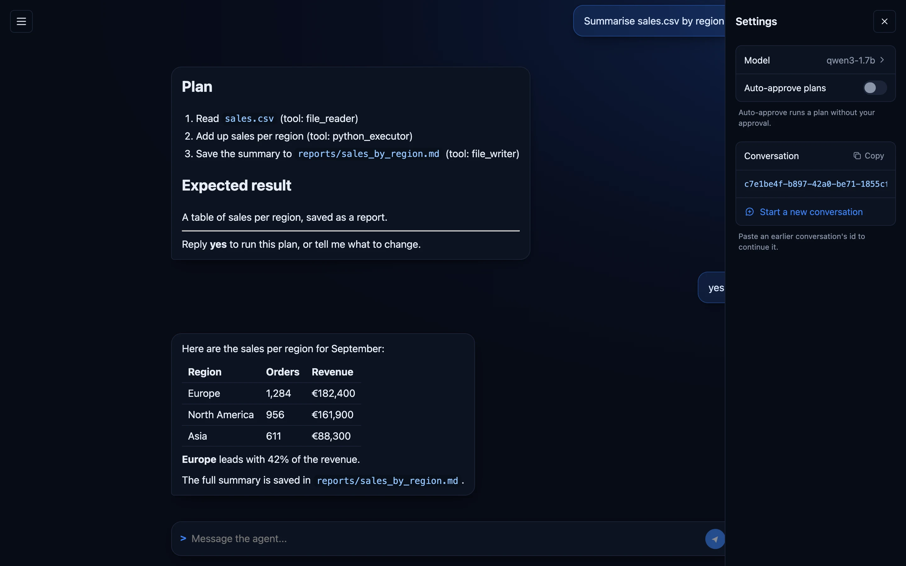

## Automate with Tasker

Build automations by connecting blocks on a canvas: a **Trigger**, **HTTP requests**, **Code**, **Transforms** and an **Output**. Run the flow and follow each block's result.

- **Several canvases side by side** — open tabs, split the workspace horizontally or vertically, and resize the panes freely.
- **Group blocks** into one reusable block, and open it to edit what is inside.
- **Saved to your account** — workflows and favourite blocks are stored in the homelab's PostgreSQL; the right panel lists your workflows, with **New canvas** to start another. Nobody else sees them.
- **Inspect any block** — select it to edit its settings and see what it returned on the last run.

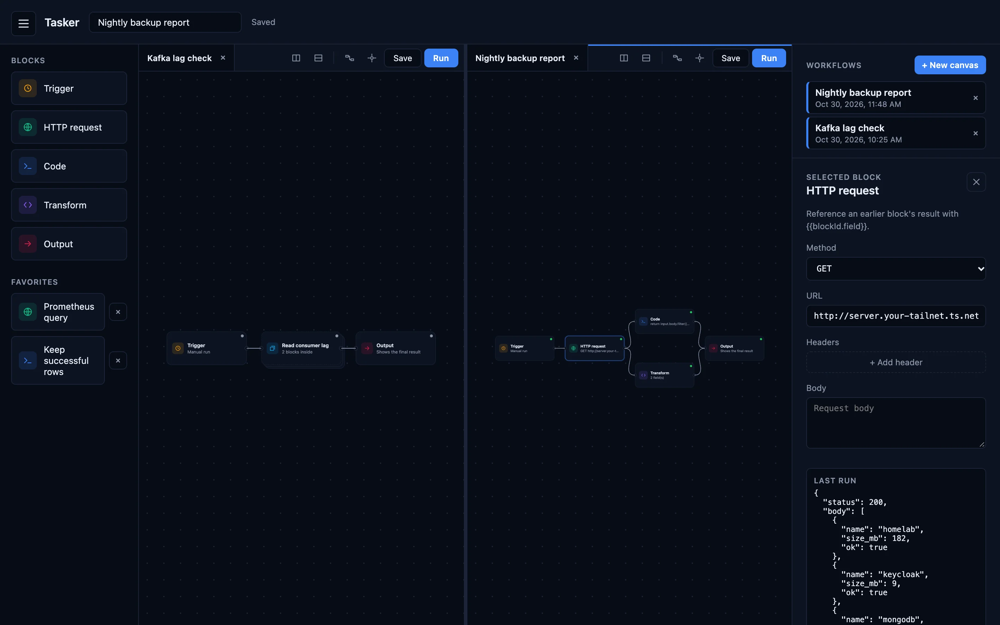

## All your tools, one menu away

The menu shows who is signed in, with **Sign out**, then lists every app and page. Those that open in a new tab — dashboards, metrics, logs, your account — are marked with a small arrow.

Below them, **Infrastructure** shows whether the services your apps rely on — PostgreSQL, MongoDB, Kafka — are **up**.

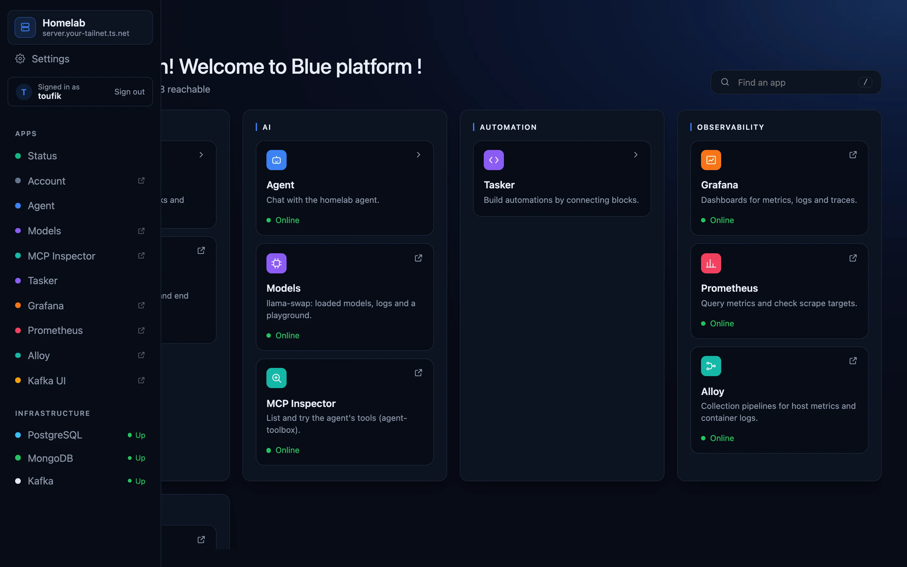

## On your phone too

The same experience on a small screen: check your services, or ask the agent something from the sofa.

<table>
  <tr>
    <td>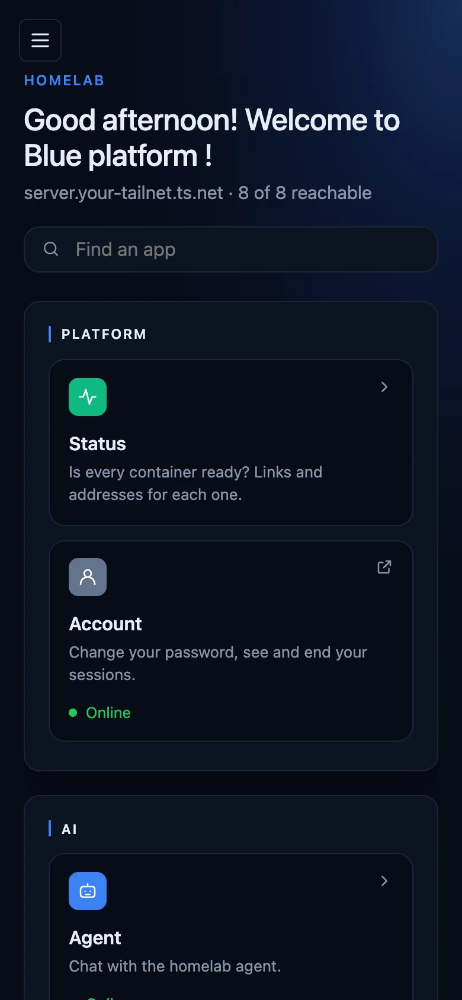</td>
    <td>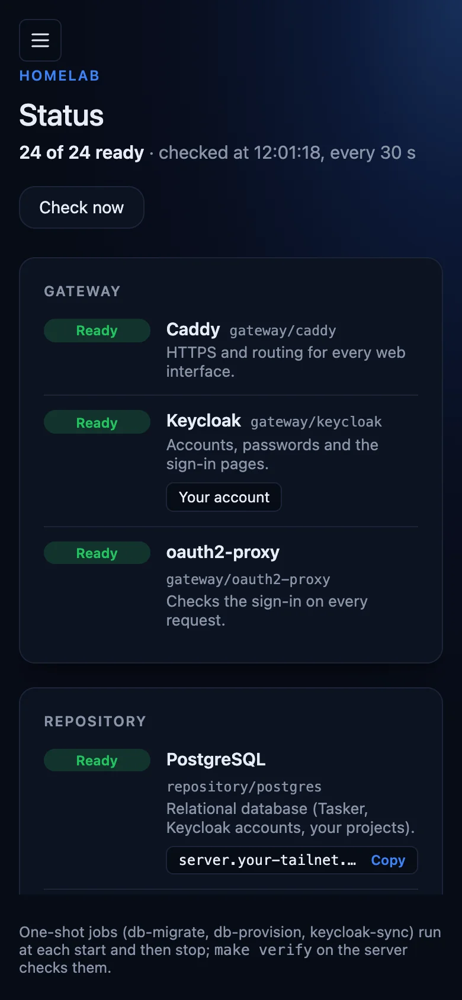</td>
    <td>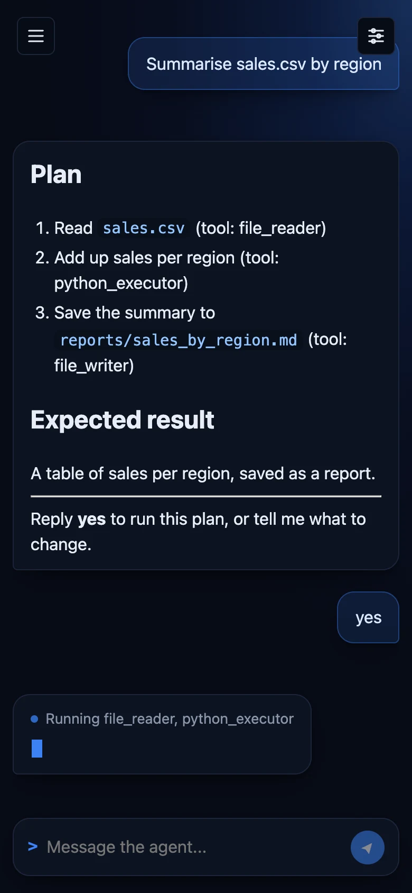</td>
  </tr>
</table>

## How it connects

The UI is one static page served by the homelab's gateway. The browser only ever talks to one HTTPS address, and one sign-in covers the UI and every tool it links to.

```text
 Browser ── https://<server>.<tailnet>.ts.net ──► Caddy ── signed in? ──► oauth2-proxy ◄──► Keycloak
                                                    │
     /                    the UI itself ◄───────────┤
     /api/agent/…         chat, models  ◄───────────┤──► agent-runtime ──► LLM, agent-toolbox
     /api/tasker/…        workflows     ◄───────────┤──► PostgREST ──► PostgreSQL (your rows only)
     /api/prometheus/…    Infrastructure◄───────────┤──► Prometheus
     /api/health/<name>   Status page   ◄───────────┘──► each container's health endpoint
     :6274                MCP Inspector ──────────────► agent-toolbox's tools
     :3000 :9090 :8080 …  links in a new tab ─────────► Grafana, Prometheus, Kafka UI, Alloy, LLM, …
```

Devices on the tailnet can also reach the agent directly: its API on `http://<server>.<tailnet>.ts.net:8000` and its tools (MCP) on `:8001/mcp`.

## Open it

On any device on your Tailscale network, open `https://<your-server>.<tailnet>.ts.net/` and sign in. Accounts are created on the server with `make user-add ACCOUNT=<name>` (see homelab-infra's `devops_guide.md`); the old address `http://<your-server>:8002` redirects there.

The left sidebar shows who is signed in, with a **Sign out** link that ends the session everywhere. The **Account** tile opens your Keycloak account page to change your password; passwords expire after 90 days, and the sign-in page then asks for a new one.

---

**Developers:** project structure, how addresses are built, adding a page, a link or a status, and publishing the image — **[docs/development.md](docs/development.md)**.
