<div align="center">


# Homelab

**Everything running in your homelab, in one place — and an assistant that can do the work for you.**

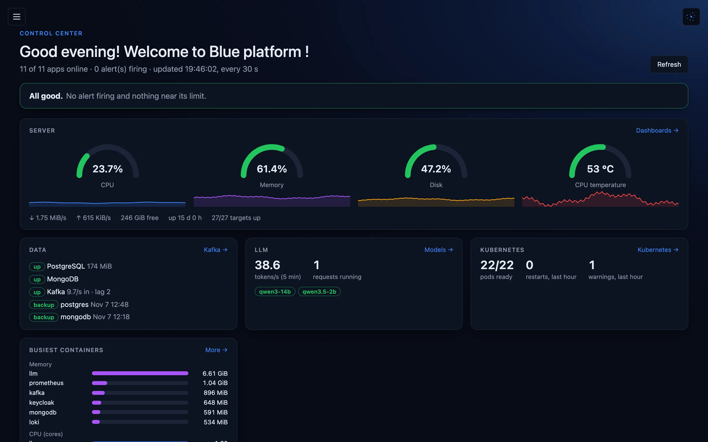

</div>

## Your homelab at a glance

The **control center** is the first page. At the top, what needs your attention: a firing alert, a disk filling up, a pod that isn't ready, a backup that didn't run — or **All good**. Below, the server's CPU, memory, disk and temperature with their last 24 hours, the databases and Kafka, the LLM's speed and loaded models, the pods, the busiest containers, the last error lines, and every app with its online status. It checks again every 30 seconds; each card opens the page behind it.

## Every tool, inside the homelab

Each tool has its own page here, in your theme, with no new tab to open:

| Page           | What you do there                                                                                                                                                                                          |
| -------------- | ---------------------------------------------------------------------------------------------------------------------------------------------------------------------------------------------------------- |
| **Dashboards** | The server, containers, Kafka, the LLM and server health as charts (Grafana's three dashboards, rebuilt)                                                                                                   |
| **Metrics**    | Run a PromQL query as a chart or a table; see every scrape target and the alert rules                                                                                                                      |
| **Logs**       | Search every container's logs with LogQL, pick a label and a value, filter by level, follow them live; a line from a traced request opens its trace                                                        |
| **Traces**     | Find a request by service, operation or duration, and follow it span by span; `/traces?trace=<id>` opens one trace                                                                                         |
| **Kafka**      | Topics, their messages, consumer groups and their lag; create or delete a topic and send a message (admins)                                                                                                |
| **Pipeline**   | Alloy's components, their health, what feeds what                                                                                                                                                          |
| **Models**     | Load and unload models, follow the LLM's logs, try a prompt                                                                                                                                                |
| **Tools**      | Every tool the agent can use — its own and the ones it gets from Grafana's, MongoDB's and PostgreSQL's MCP servers (`grafana_*`, `mongodb_*`, `postgres_*`); fill in its arguments and run it              |
| **Account**    | Your name and email, your devices and sessions (sign one out), and changing your password                                                                                                                  |
| **Tool UIs**   | Links to each tool's own web interface — Grafana, Prometheus, Kafka UI, Alloy, the LLM playground, MCP Inspector, the agent's API docs, Headlamp (admins), your Keycloak account — with whether it answers |
| **Kubernetes** | Admins only: nodes, pods, workloads, services, volumes, secrets and events; scale, restart, run a cron job now, delete, edit an object's YAML, read a pod's logs and open a shell in it                    |

<table>
  <tr>
    <td>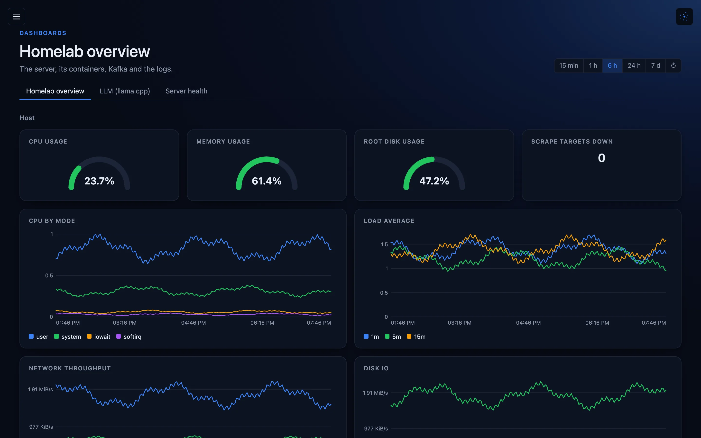</td>
    <td>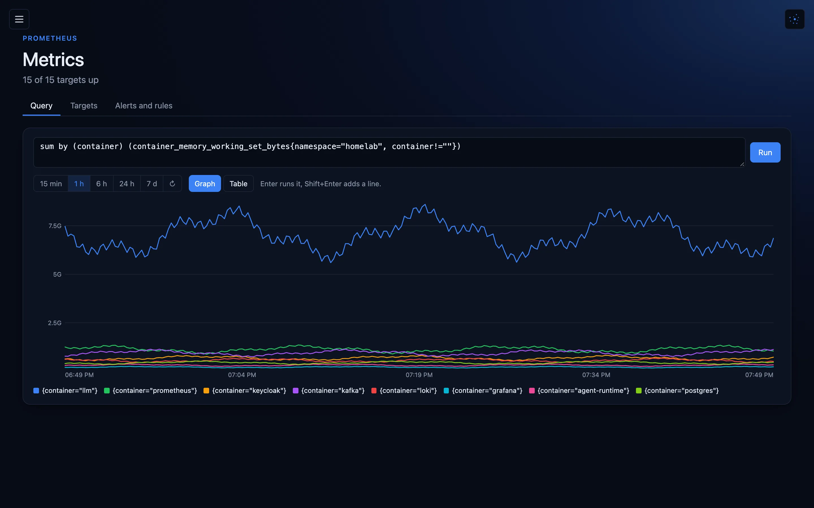</td>
  </tr>
  <tr>
    <td>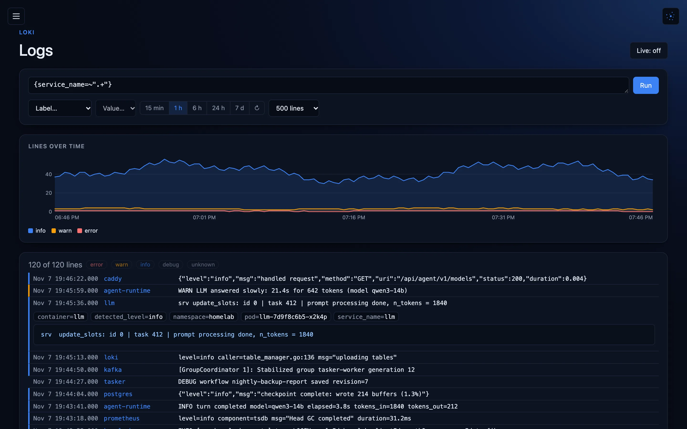</td>
    <td>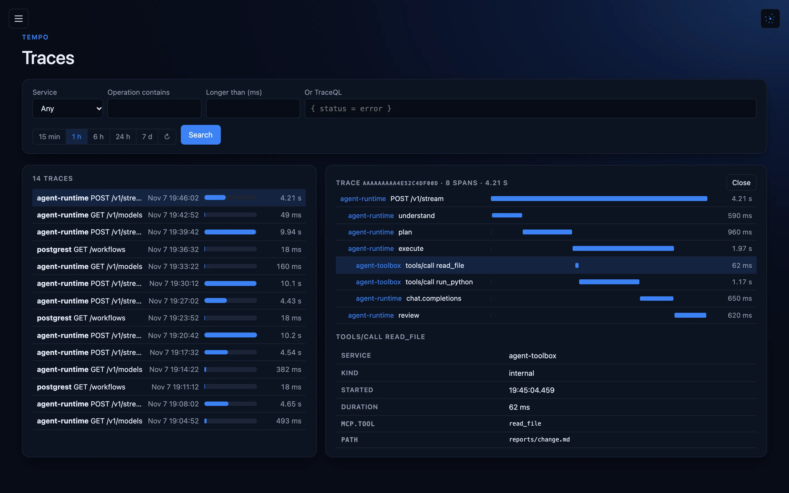</td>
  </tr>
  <tr>
    <td>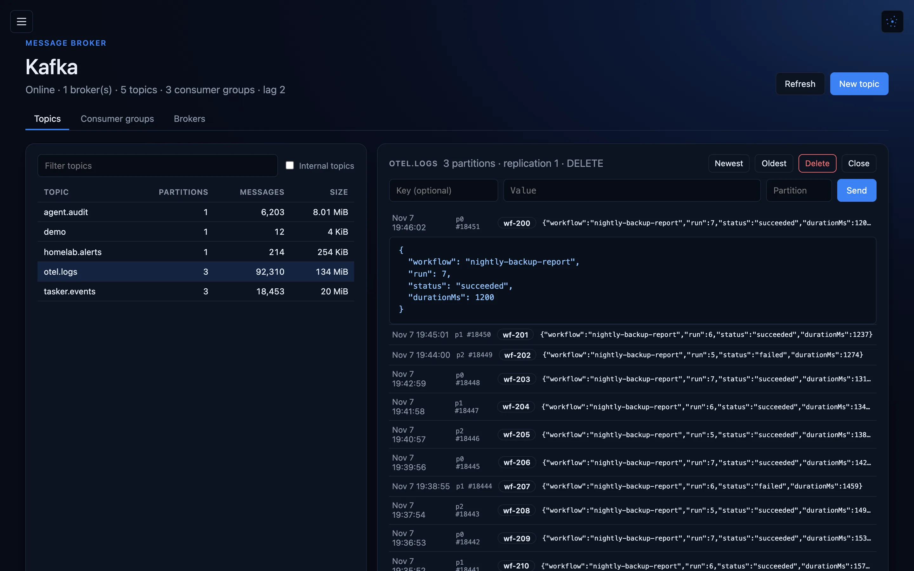</td>
    <td>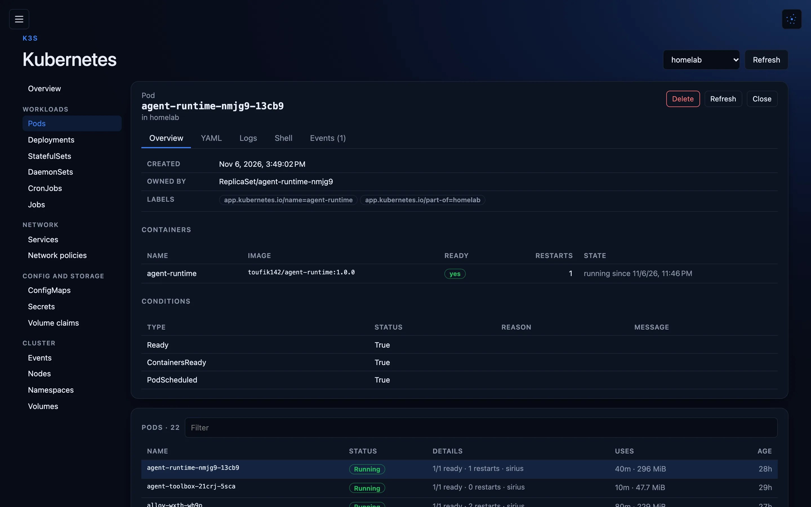</td>
  </tr>
  <tr>
    <td>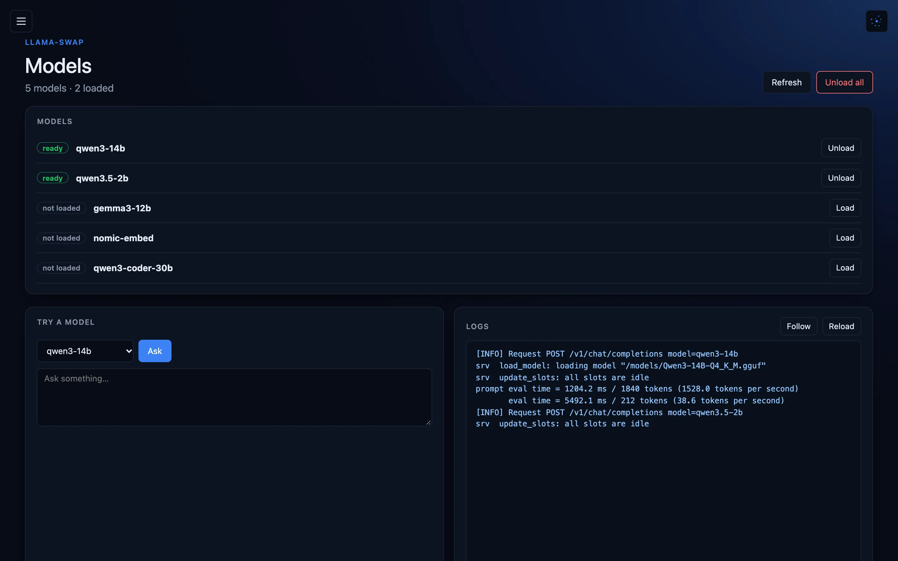</td>
    <td>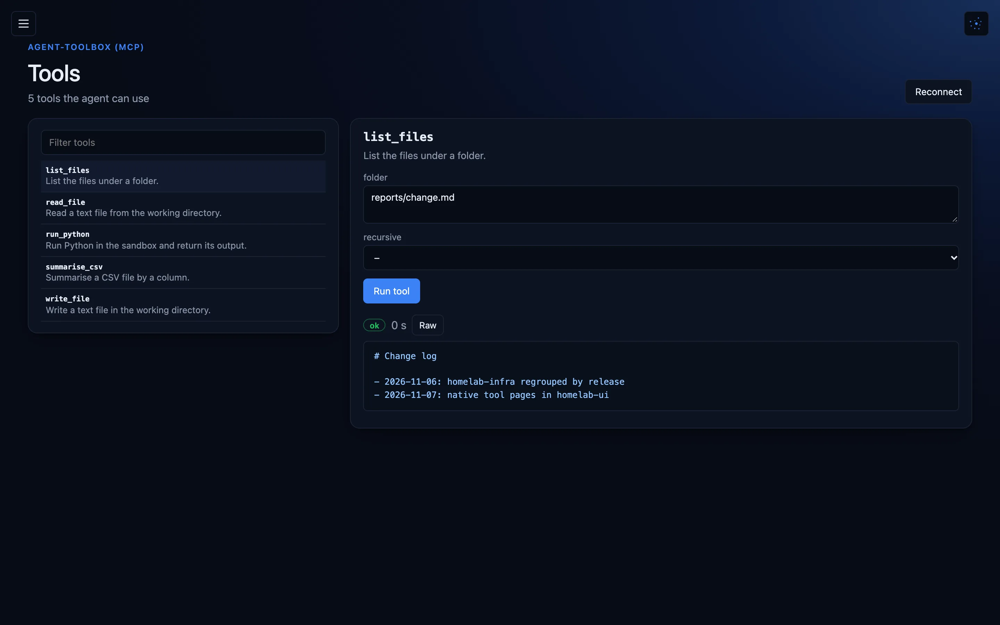</td>
  </tr>
</table>

Admins can change things where it makes sense — scale a deployment, delete a topic, unload a model — and every change that can't be undone asks you to confirm it first, the way the server's `make` commands do.

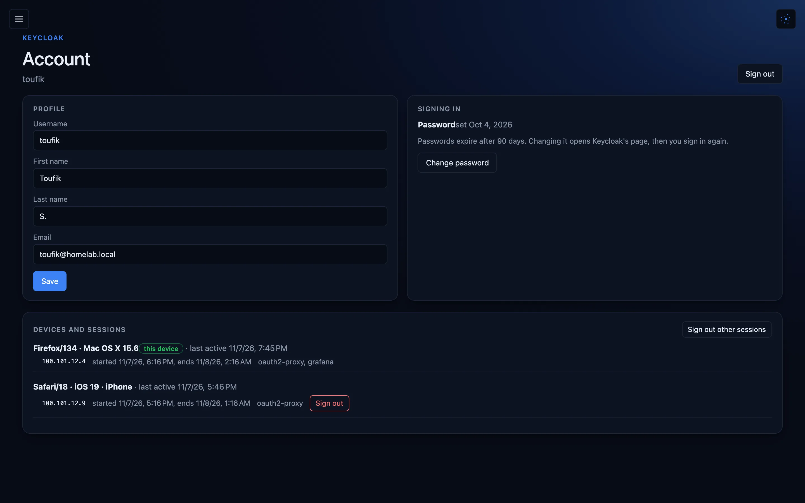

## Check every container

The **Status** page lists every container of the homelab, grouped the way the server is organised — Gateway, Repository, Message broker, Observability, LLM, Apps — each marked **Ready**, **Not ready** or **Unknown**. The top line counts how many are ready; the page checks again every 30 seconds, or at once with **Check now**.

Every service also carries what you need to use it:

- **links** to its page here — Dashboards, Metrics, Logs, Traces, Kafka, Pipeline, Models, Tools, your Account — and to the agent's API docs;
- its **connection address**, ready to copy — the MongoDB URI, Kafka's bootstrap server, the OTLP endpoints, the LLM's OpenAI-compatible URL;
- the **folder** it lives in on the server, for when you need to look at its configuration.

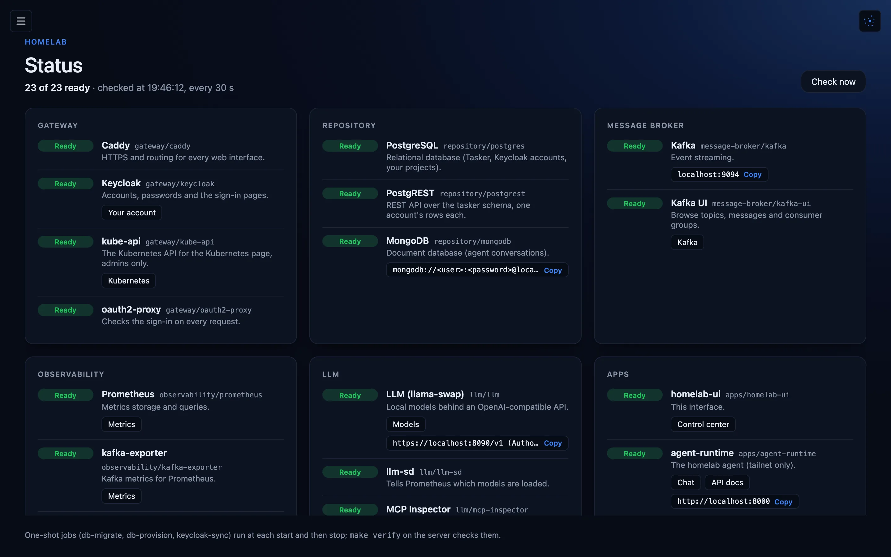

## Ask the agent

Ask in plain words, the way you would ask a colleague: _"Summarise sales.csv by region"_, _"What's in change.md?"_, _"Which tools can you use?"_.

A question it can answer straight away — _"What is a KV cache?"_ — comes back **as it is written**: the words appear one after another, so you can start reading at once. While the agent works, a small swarm of dots moves in your theme's colours: calm while it thinks, faster while it runs a tool, red if something went wrong.

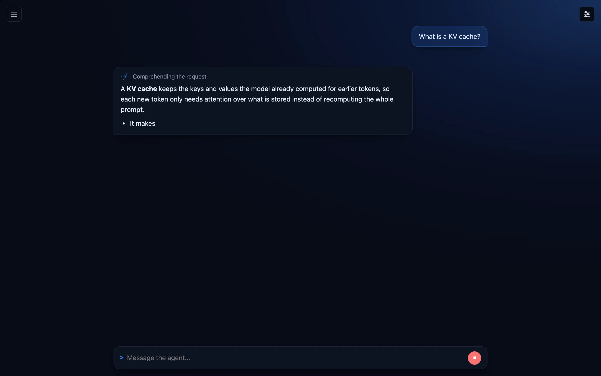

When a request needs real work — reading files, crunching numbers, saving a report — the agent first shows you **its plan**. Reply **yes** and it gets to work, showing what it is doing as it goes, then gives you the result. Reply **Drop plan** to cancel it, or say what to change and it comes back with a new plan.

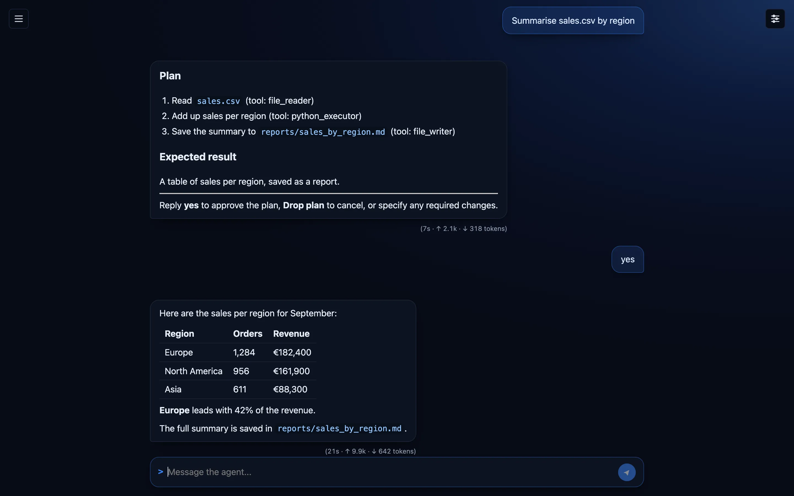

Under each answer you see how long it took and how many tokens went in and out, like _(21s · ↑ 9.9k · ↓ 642 tokens)_. Hover over the answer for a button that copies it, and an arrow that opens everything the agent reported about it: the model, the tools it used, the steps it took, and any detail the agent adds later.

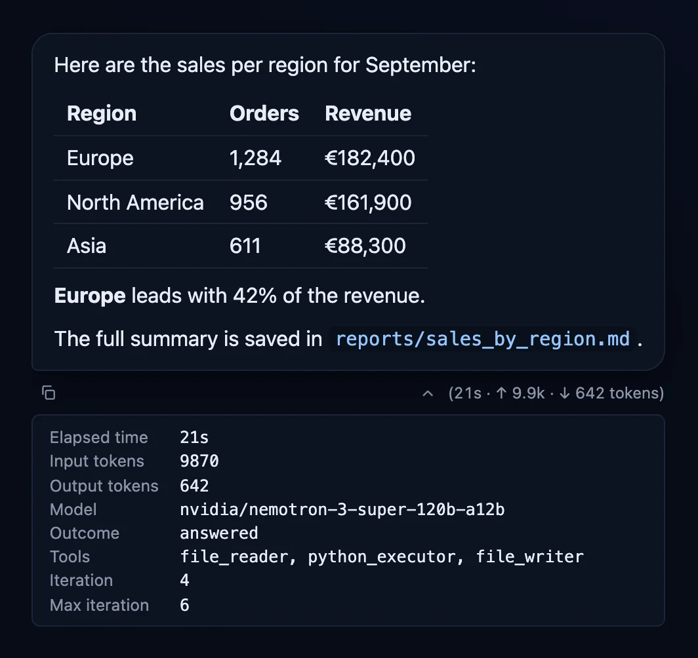

## The assistant on every page

The assistant button at the top right opens the agent beside any page. It is the same conversation as the Agent page: ask about an error on the Logs page, carry on with it on the Agent page. Choose the model, start a new conversation, or open the Agent page from the panel; **Esc** or ✕ closes it.

Drag the panel's left edge to make it wider or narrower (double-click it to reset); the width is remembered on that device, and on a wide screen the page makes room for it. Close the panel while the agent is working and the button keeps moving, so you know an answer is on its way.

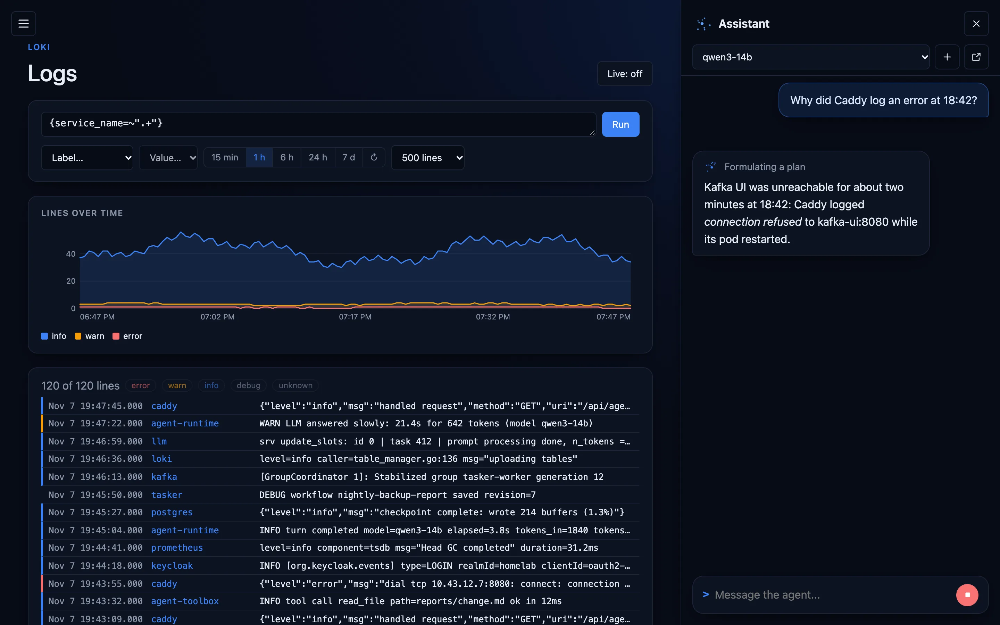

## Stay in control

The settings panel lets you choose the **model** that answers, start a **new conversation**, or pick up an old one by pasting its id. The list of models comes from the agent itself: when a new model is added there, it shows up here.

Trust the agent with a task? Turn on **Auto-approve plans** and it carries out its plans without waiting for your yes. Your model and auto-approve choices are **remembered** on that device.

At the bottom, **Fixed by the server** shows the steps that always use the same model whatever you pick — for example understanding your request or writing a plan.

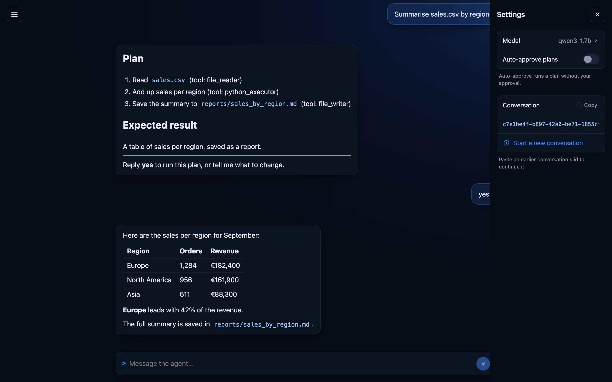

## Automate with Tasker

Build automations by connecting blocks on a canvas: a **Trigger**, **HTTP requests**, **Code**, **Transforms** and an **Output**. **Run** starts from every block nothing feeds into — a Trigger, or a block on its own — and you follow each block's result.

- **Several canvases side by side** — open tabs, split the workspace horizontally or vertically, and resize the panes freely.
- **Name your blocks** so the canvas reads like the flow; a block saved as a favorite takes the favorite's name, and comes back with it when you add the favorite.
- **Group blocks** into one reusable block, and open it to edit what is inside.
- **Saved to your account** — workflows and favourite blocks are stored in the homelab's PostgreSQL; the right panel lists your workflows, with **New canvas** to start another. Nobody else sees them.
- **Inspect any block** — select it to edit its settings and see what it returned on the last run.

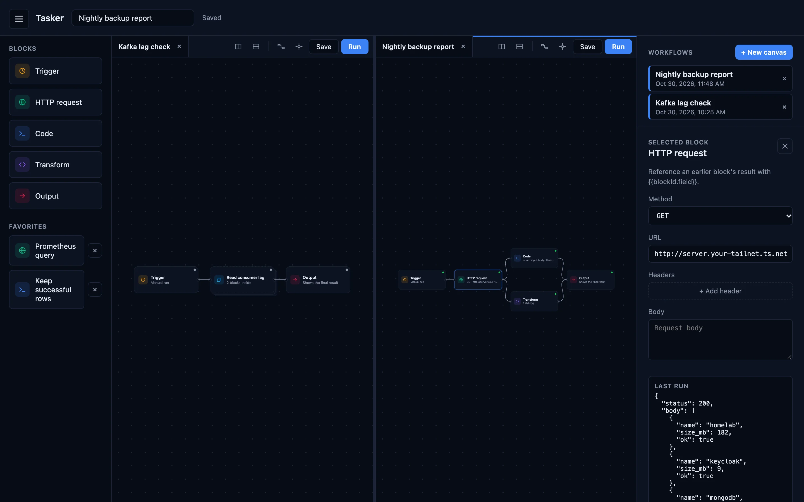

## All your tools, one menu away

The menu shows who is signed in, with **Sign out**, then every page grouped by what it does — Platform, AI, Automation, Observability, Streaming; the Kubernetes page is listed only for admins. Below them, **Infrastructure** shows whether the services your apps rely on — PostgreSQL, MongoDB, Kafka — are **up**.

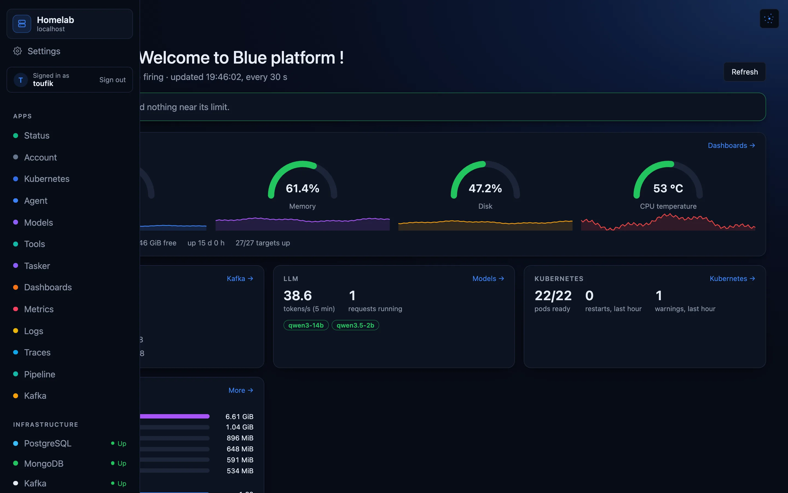

## On your phone too

The same experience on a small screen: glance at the control center, check your services, or ask the agent something from the sofa.

<table>
  <tr>
    <td>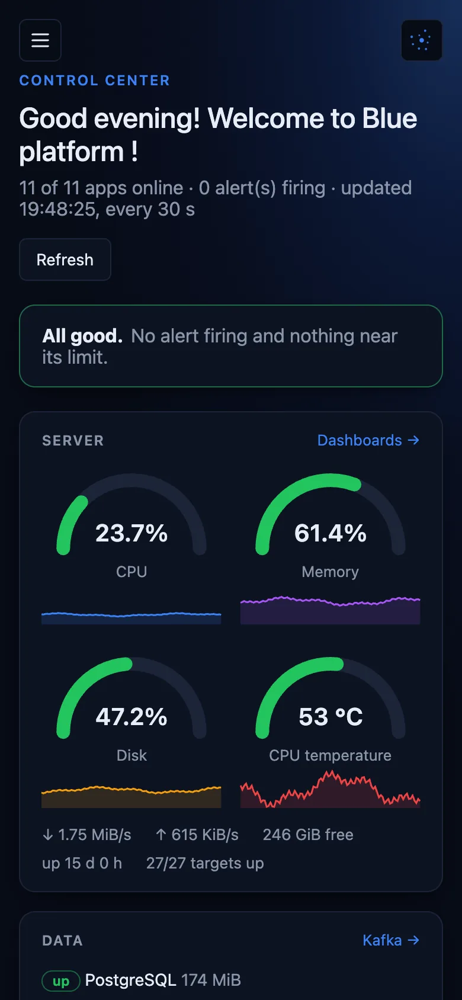</td>
    <td>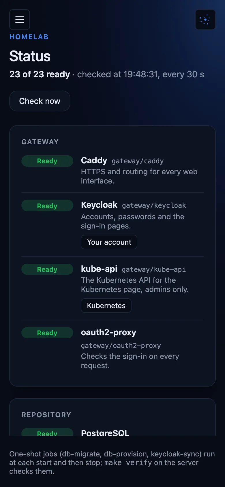</td>
    <td>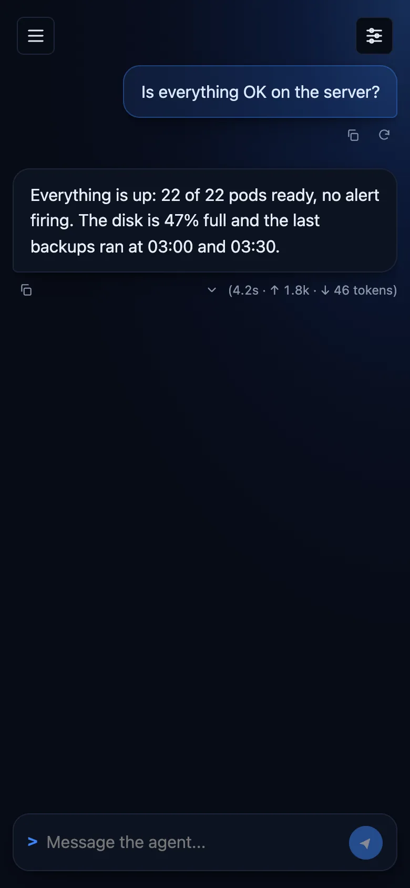</td>
  </tr>
</table>

## How it connects

The UI is one static page served by the homelab's gateway. The browser only ever talks to one HTTPS address, and one sign-in covers the UI and every tool it links to.

```text
 Browser ── https://<server>.<tailnet>.ts.net ──► Caddy ── signed in? ──► oauth2-proxy ◄──► Keycloak
                                                    │
     /                    the UI itself ◄───────────┤
     /api/agent/…         chat, models  ◄───────────┤──► agent-runtime ──► LLM, agent-toolbox
     /api/tasker/…        workflows     ◄───────────┤──► PostgREST ──► PostgreSQL (your rows only)
     /api/prometheus/…    Metrics       ◄───────────┤──► Prometheus
     /api/loki/ tempo/    Logs, Traces  ◄───────────┤──► Loki, Tempo
     /api/kafka/…         Kafka         ◄───────────┤──► Kafka UI's API ──► Kafka
     /api/alloy/ llm/     Pipeline, Models ◄────────┤──► Alloy, llama-swap
     /api/toolbox/mcp     Tools         ◄───────────┤──► agent-toolbox (MCP)
     /api/account/…       Account       ◄───────────┤──► Keycloak's account API
     /api/kube/…          Kubernetes    ◄───────────┤──► kube-api ──► Kubernetes API (admins)
     /api/health/<name>   Status page   ◄───────────┘──► each container's health endpoint
```

Changes (anything but reading) carry the header `X-Homelab-Request: 1`, which the gateway requires so another site can't make them in your name.

Devices on the tailnet can also reach the agent directly: its API on `http://<server>.<tailnet>.ts.net:8000` and its tools (MCP) on `:8001/mcp`.

## Open it

On any device on your Tailscale network, open `https://<your-server>.<tailnet>.ts.net/` and sign in. Accounts are created on the server with `make user-add ACCOUNT=<name>` (see homelab-infra's `devops_guide.md`); the old address `http://<your-server>:8002` redirects there.

The left sidebar shows who is signed in, with a **Sign out** link that ends the session everywhere. The **Account** page changes your profile and password; passwords expire after 90 days, and the sign-in page then asks for a new one. The Kubernetes page, Kafka changes and unloading a model need the `admin` role (`make user-admin ACCOUNT=<name>` on the server).

---

The screenshots show sample data.

**Developers:** project structure, how addresses are built, adding a page or a status, the shared charts, and publishing the image — **[docs/development.md](docs/development.md)**.
